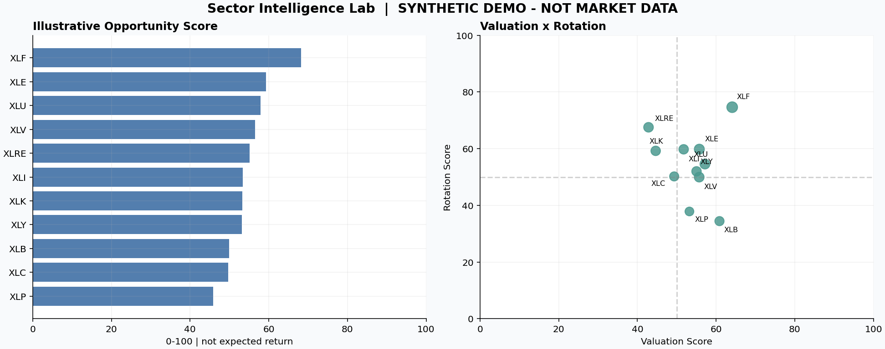
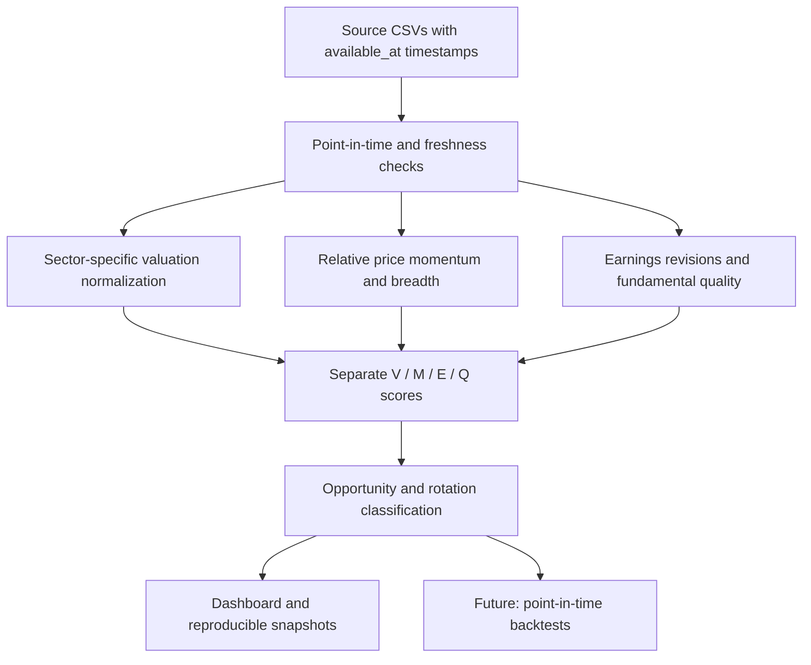

# Sector Intelligence Lab

**A reproducible, research-first framework for US equity sector valuation and rotation.**

> **Status: Research scaffold v0.1.0.** The included data are **100% synthetic**. The output is a software demonstration, **not** measured ETF mispricing, an investment signal, or a backtest. No outperformance is claimed.

## The research question

Can sector-specific historical valuation, relative-price strength, earnings-estimate revisions and fundamental quality help identify which of the 11 US equity sectors deserve deeper research? The project separates **cheapness** from **confirmation** and treats all forward-return claims as hypotheses pending point-in-time backtesting.

**ETF universe:** `XLK`, `XLC`, `XLY`, `XLP`, `XLE`, `XLF`, `XLV`, `XLI`, `XLB`, `XLRE`, `XLU`. Benchmark: `SPY`.



*Illustrative synthetic signals only. No live data or historical performance claims.*

## Research design

| Model | Purpose | Default output |
|---|---|---|
| Valuation | Historical cheapness using sector-specific multiples | V: 0–100 |
| Momentum | Relative 6–1, 12–1 and 3M momentum, plus breadth | M: 0–100 |
| Revision | 1M/3M estimate changes and breadth | E: 0–100 |
| Quality | Profitability, balance-sheet strength and durability | Q: 0–100 |
| Opportunity | Prioritize diligence, not place trades | `0.40V + 0.25M + 0.20E + 0.15Q` |
| Rotation | Strength of market and fundamental confirmation | `0.55M + 0.45E` |

Historical valuation uses a **past-only, median/MAD-based robust Z-score** with an 84-month reference window and a 48-month minimum. High valuation multiples are directionally reversed; cash-flow yields are not. Missing pillars do not become neutral scores.

### Architecture



## Run the synthetic demo

Requires Python 3.11 or later.

```bash
python -m venv .venv
# Activate the environment with your OS-specific command.
pip install -e ".[dev,app]"
python scripts/make_demo_data.py
python scripts/run_pipeline.py
pytest -q
streamlit run app.py
```

The demo generator fixes the random seed and provides approximately 10 years of fictional monthly multiple observations, daily adjusted-price proxy series and sector score inputs. Its output lives in `data/demo/` and `data/processed/`. The dashboard repeatedly labels results as simulated.

**Real-data inputs:** See [`docs/DATA_POLICY.md`](docs/DATA_POLICY.md) for CSV schemas and the requirements for *true* point-in-time sourcing. The package does **not** include an unlicensed data feed or assert that web-scraped historical valuation is accurate.

## What has and has not been built

- [x] Eleven-sector coverage, configurable metric weights and investor-readable classifications.
- [x] Robust, past-only valuation transformation and no silent score imputation.
- [x] Relative-price momentum, cross-sectional revision ranking and quality aggregation.
- [x] Deterministic synthetic example, interactive viewer and basic unit tests.
- [ ] Validated point-in-time histories of ETF holdings, estimates and sector fundamentals.
- [ ] Constituent-level and subindustry valuation aggregation; historical relative P/E spread.
- [ ] Data lineage and production-grade backfill/revision controls.
- [ ] Leakage-free walk-forward 3/6/12-month excess-return backtests, costs and robustness checks.
- [ ] Deployed public live-data dashboard and a research findings page.

## Limitations that matter

1. Valuation cheapness is **not** intrinsic undervaluation or a forecast of positive return.
2. Current ETF constituents cannot reconstruct an unbiased historical sector index.
3. Adjusted price is not necessarily identical to a validated dividend-reinvested total-return index.
4. Sector averages require careful treatment of banks, insurers, cyclicals and REITs.
5. Cross-sector ranks are *relative rankings*, not calibrated probabilities.
6. No live market data or empirical return claims are supplied in v0.1.

See [Methodology](docs/METHODOLOGY.md), [Data policy](docs/DATA_POLICY.md), and [Roadmap](docs/ROADMAP.md).

## Repository map

```text
sector-intelligence-lab/
  src/sectorlab/       # sector universe, factor and scoring engine
  scripts/             # deterministic demo generator and scoring runner
  tests/               # leakage, arithmetic and incomplete-data tests
  data/demo/           # synthetic demo inputs (generated)
  data/processed/      # reproducible signal output (generated)
  docs/                # methodology, sources, roadmap and resume language
  app.py               # optional Streamlit viewer
  .github/workflows/   # automated pytest checks
```

## For reviewers / prospective collaborators

The interesting work is **not** whether one sector tops a demo ranking. The goal is to test whether a valuation + revision/rotation framework has incremental predictive value under realistic point-in-time constraints. See `docs/ROADMAP.md` for intended ablations, leakage defenses, transaction-cost treatment and out-of-sample acceptance criteria.

## Disclaimer

Independent educational research. Not affiliated with State Street, S&P Global, or any index provider. ETF names and ticker symbols are used for identification only. This project is not financial advice and makes no performance or alpha claims.

## License

MIT. Contributions and reproducibility feedback are welcome.
