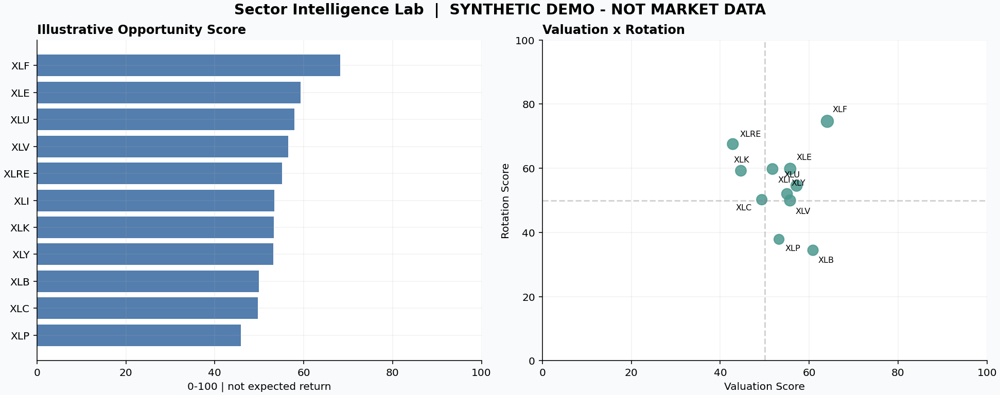
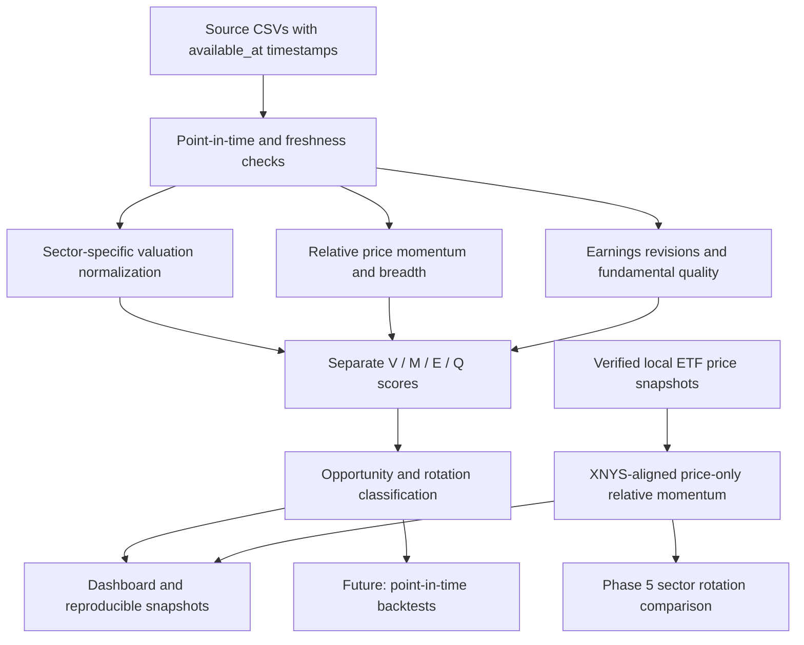

# Sector Intelligence Lab

**A reproducible, research-first framework for US equity sector valuation and rotation.**

> **Status: Research scaffold v0.1.0.** The included demo is **100% synthetic**. Separate research views cover price momentum, sector valuation, earnings revisions and fundamental quality. Empirical performance and live vendor data remain unvalidated.

## The research question

Can sector-specific historical valuation, relative-price strength, earnings-estimate revisions and fundamental quality help identify which of the 11 US equity sectors deserve deeper research? The project separates **cheapness** from **confirmation** and treats all forward-return claims as hypotheses pending point-in-time backtesting.

**ETF universe:** `XLK`, `XLC`, `XLY`, `XLP`, `XLE`, `XLF`, `XLV`, `XLI`, `XLB`, `XLRE`, `XLU`. Benchmark: `SPY`.



*Illustrative synthetic signals only. No live data or historical performance claims.*

## Research design

| Model | Purpose | Default output |
|---|---|---|
| Valuation | Historical cheapness using sector-specific multiples | V: 0–100 |
| Price Momentum | Rank 6–1, 12–1 and 3M adjusted-price momentum versus SPY | 0–100, price research tab |
| Momentum | Relative 6–1, 12–1 and 3M momentum, plus breadth | M: 0–100 |
| Revision | 1M/3M estimate changes and breadth | E: 0–100 |
| Quality | Profitability, balance-sheet strength and durability | Q: 0–100 |
| Opportunity | Prioritize diligence, not place trades | `0.40V + 0.25M + 0.20E + 0.15Q` |
| Rotation | Strength of market and fundamental confirmation | `0.55M + 0.45E` |

Sector Valuation Research uses a past-only median/MAD robust Z-score with an
84-calendar-month reference window and a 48-month minimum. Lower multiples and
higher yields imply higher attractiveness. The optional SPY comparison needs
compatible point-in-time observations.

### Architecture



## Run the synthetic demo

Requires Python 3.11 or later.

```bash
python -m venv .venv
# Activate the environment with your OS-specific command.
pip install -e ".[dev,app]"
python scripts/make_demo_data.py
python scripts/run_pipeline.py
pytest -q
streamlit run app.py
```

The demo generator fixes the random seed and provides approximately 10 years of fictional monthly multiple observations, daily adjusted-price proxy series and sector score inputs. Its output lives in `data/demo/` and `data/processed/`. The dashboard repeatedly labels results as simulated.

**Real-data inputs:** See [`docs/DATA_POLICY.md`](docs/DATA_POLICY.md) for CSV schemas and the requirements for *true* point-in-time sourcing. The package does **not** include an unlicensed data feed or assert that web-scraped historical valuation is accurate.

## Ingest historical daily ETF prices (Phases 1 and 6A)

Import licensed daily prices for the 11 US sector ETFs and SPY using a local CSV.
The importer validates listing dates, trading sessions, price and action fields,
and preserves the original input and provenance with SHA-256 checksums.

```bash
python scripts/ingest_market_data.py --csv work/prices.csv \
  --provenance work/provenance.json --start 2023-01-03 --end 2024-12-31 \
  --snapshot historical-2024-v1
```

The existing Alpha Vantage route uses the documented premium Daily Adjusted API.
Both routes save Git-ignored snapshots under `data/market/`. See the
[provider comparison, CSV schema and EOD workflow](docs/HISTORICAL_DATA.md) and
[Alpha Vantage instructions](docs/MARKET_DATA.md). Phase 6A verified the workflow
with fictional prices. Real coverage remains unverified pending a licensed export.

### Capture private IBKR history (Phase 6B)

Run the [local TWS or IB Gateway preflight](docs/IBKR_HISTORY.md) with the socket
API in read-only mode. Capture `TRADES` and `ADJUSTED_LAST` for the 11 sector ETFs
and SPY, inspect coverage, and replay the archive offline. A Phase 6A export
requires independently sourced as-traded OHLCV and reconciled corporate actions.
Keep licensed inputs, snapshots and reports outside the checkout and public cloud.

## Run Price Momentum Research (Phase 2)

Place an intact market snapshot under `data/market/`. Start the app with
`streamlit run app.py`, then select the snapshot and a signal session in the
**Price Momentum Research** tab. A covered 12–1 window requires at least 253
exchange sessions in the snapshot. The tab shows sector ranks, the 6–1, 12–1
and 3M components, relative performance versus SPY, historical scores, and
coverage and provenance. It works independently of the **Synthetic Demo** tab.

To reproduce the results offline from a saved snapshot, install `.[dev,app]`
as above and run the following from the repository root:

```python
from sectorlab.market_data import load_snapshot
from sectorlab.price_momentum import price_momentum_history

snapshot = load_snapshot("data/market/av-2023-2024-v1")
history = price_momentum_history(snapshot, asof="2024-12-31")
latest = history.loc[history["signal_date"] == history["signal_date"].max()]
print(latest.sort_values("price_momentum_rank").to_string(index=False))
```

Use the same files and package versions to reproduce the signal history.
`pytest -q` uses fictional inputs and requires no API key. See
[Methodology](docs/METHODOLOGY.md#price-momentum-score-phase-2) for formulas,
eligibility, and the distinction between the price-only score and breadth-based
Momentum. The price research tab publishes only price-derived metrics.

## Run Sector Valuation Research (Phase 3)

Open **Sector Valuation Research** in `streamlit run app.py`. Choose
**Import local CSV** for a validated export or **Synthetic demonstration** for
fictional data. Select a sector, metric and as-of date to view valuation
history, robust Z-scores, attractiveness scores, percentiles, and coverage.
Forward P/E and dividend yield can be compared to SPY when observations and
definitions align. The historical, relative and 70/30 scores appear separately.
This tab works independently of Price Momentum Research and the legacy synthetic demo.

The [CSV contract](docs/VALUATION_DATA.md) covers private storage, reproducible
Python usage and validation. See the [data feasibility report](docs/DATA_FEASIBILITY.md)
for the source review. A licensed original-vintage market dataset is still required
to run and validate real valuation histories.

## Run Earnings and Quality Research (Phase 4)

Run `streamlit run app.py`, open **Earnings and Quality**, and choose **Synthetic
fixture** for the offline example across all 11 sector ETFs. The three views show
Earnings Revision Research, Fundamental Quality Research, and Sector Coverage and
Source Confidence. For local data, place validated CSVs under the ignored
`data/earnings_quality/` directory and select a timestamp with a UTC offset.

Earnings uses matched analyst EPS vintages and recommendation breadth. Quality
uses issuer-level ratios and subindustry definitions for profitability, financial
strength and growth durability. Both require sufficient historical ETF weight
coverage and expose missing inputs. The real-data Opportunity Score remains inactive.

- [Phase 4 source feasibility](docs/PHASE4_FEASIBILITY.md)
- [Phase 4 CSV contract and offline API](docs/EARNINGS_QUALITY_DATA.md)
- [Phase 4 methodology and limitations](docs/METHODOLOGY.md#earnings-revision-and-fundamental-quality-research-phase-4)

## Run sector rotation backtests (Phase 5)

```bash
python scripts/run_backtest.py --fixture --output work/phase5-common
```

Phase 5 compares SPY buy and hold, equal-weight sectors, and the Phase 2 top-three
and top-five portfolios. It validates local price snapshots and exports signals,
next-session-close trades, gross and net returns, and aligned performance metrics.
The default research universe requires all 11 sectors to be eligible. Use
`--snapshot data/market/historical-2024-v1` in place of `--fixture` to run a
saved snapshot. Real-price runs carry the `RETROSPECTIVE_ADJUSTED_PRICE_PROXY`
label. Historical point-in-time availability and total returns remain unverified. The Streamlit **Sector Rotation Backtest** tab
runs the same comparison on saved local snapshots. See [Phase 5 backtesting](docs/BACKTESTING.md).

## What has and has not been built

- [x] Eleven-sector coverage, configurable metric weights and investor-readable classifications.
- [x] Robust, past-only valuation transformation and no silent score imputation.
- [x] Relative-price momentum, cross-sectional revision ranking and quality aggregation.
- [x] Deterministic synthetic example, interactive viewer and basic unit tests.
- [x] Modular real-price ingestion, local provenance snapshots and mocked provider tests.
- [x] Snapshot-verified sector momentum rankings and retrospective signal history.
- [ ] Validated point-in-time histories of ETF holdings, estimates and sector fundamentals.
- [x] Valuation CSV import, provenance and replay, sector-specific scores and comparable SPY premiums.
- [ ] Constituent-level and subindustry valuation aggregation.
- [ ] Data lineage and production-grade backfill/revision controls.
- [x] Retrospective ETF rotation simulator with next-session execution and configurable costs.
- [ ] Validated PIT backtests, forward excess-return tests and robustness checks.
- [ ] Deployed public live-data dashboard and a research findings page.

## Limitations that matter

1. Valuation cheapness is **not** intrinsic undervaluation or a forecast of positive return.
2. Current ETF constituents cannot reconstruct an unbiased historical sector index.
3. Adjusted price is not necessarily identical to a validated dividend-reinvested total-return index.
4. Sector averages require careful treatment of banks, insurers, cyclicals and REITs.
5. Cross-sector ranks are *relative rankings*, not calibrated probabilities.
6. Real-price ingestion requires vendor access. Historical diagnostics use one retrieved vintage, which can include later adjustments and corrections.

See [Methodology](docs/METHODOLOGY.md), [Data policy](docs/DATA_POLICY.md), and [Roadmap](docs/ROADMAP.md).

## Repository map

```text
sector-intelligence-lab/
  src/sectorlab/       # sector universe, scoring engine and market_data package
  scripts/             # demo generator, scoring runner and real-price ingestion
  tests/               # leakage, arithmetic and incomplete-data tests
  data/demo/           # synthetic demo inputs (generated)
  data/processed/      # reproducible signal output (generated)
  data/market/         # local vendor snapshots (generated, Git-ignored)
  data/valuation/      # private valuation exports (optional, Git-ignored)
  docs/                # methodology, sources, roadmap and resume language
  data/earnings_quality/ # private earnings and quality bundles (optional, Git-ignored)
  app.py               # optional Streamlit viewer
  .github/workflows/   # automated pytest checks
```

## For reviewers / prospective collaborators

The interesting work is **not** whether one sector tops a demo ranking. The goal is to test whether a valuation + revision/rotation framework has incremental predictive value under realistic point-in-time constraints. See `docs/ROADMAP.md` for intended ablations, leakage defenses, transaction-cost treatment and out-of-sample acceptance criteria.

## Disclaimer

Independent educational research. Not affiliated with State Street, S&P Global, or any index provider. ETF names and ticker symbols are used for identification only. This project is not financial advice and makes no performance or alpha claims.

## License

MIT. Contributions and reproducibility feedback are welcome.
